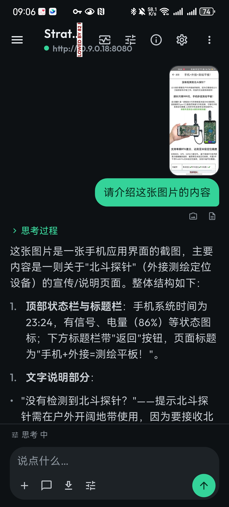
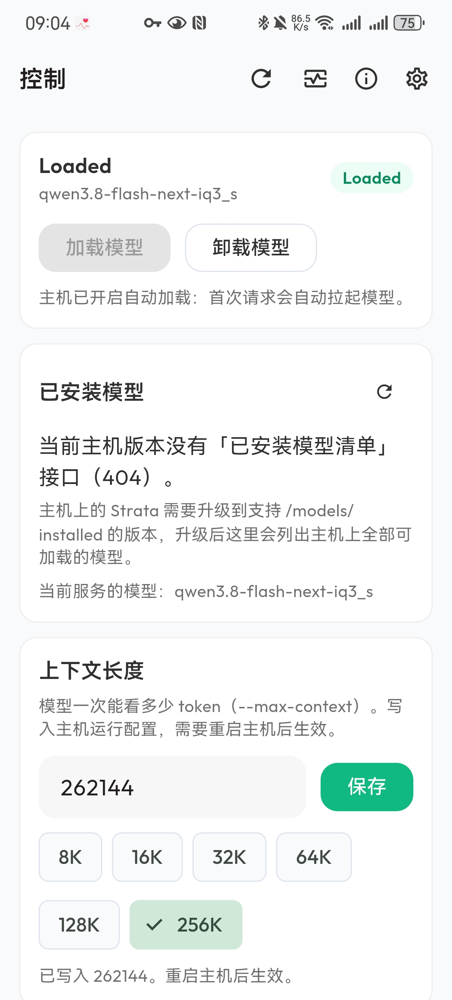
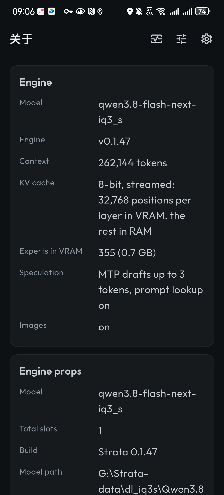
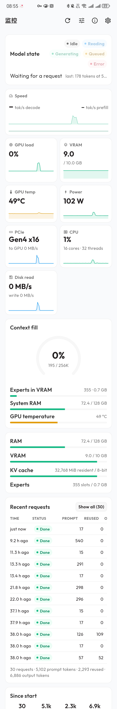
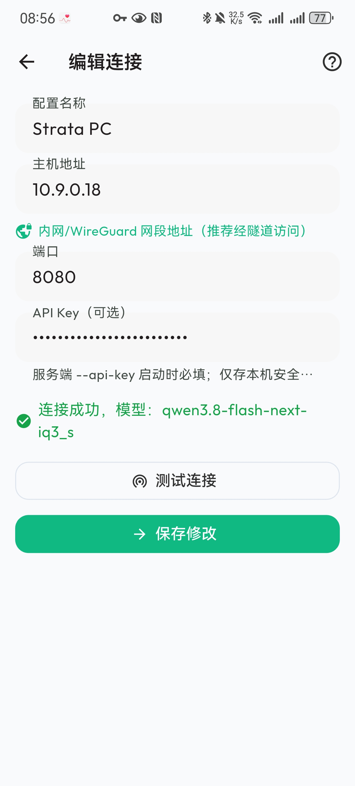
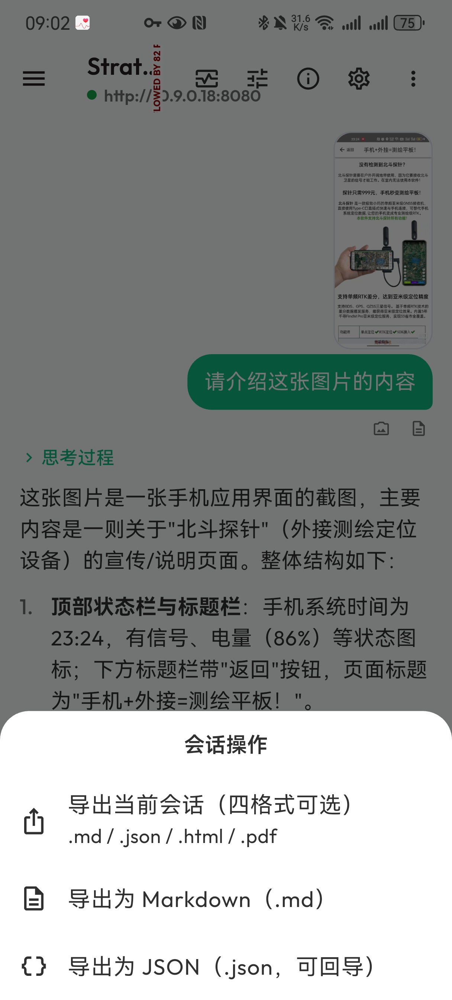
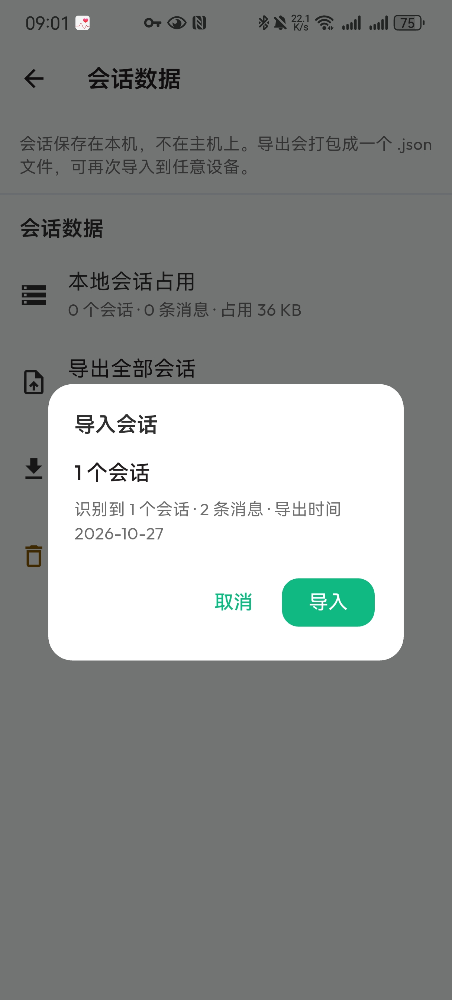

<div align="center">

# Strata Mobile Controller

**在手机上控制你自己机器上运行的 [Strata](https://github.com/Niko1221/Strata) 推理引擎。**

通过私有网络，随时与本地引擎流式对话、实时监控、加载卸载模型。

[](https://docs.flutter.dev/)
[](https://dart.dev/)
[](https://www.android.com/)
[](LICENSE)
[](CODE_OF_CONDUCT.md)

[用户手册](docs/用户手册.md) · [界面功能说明](docs/screenshots.md) · [更新日志](CHANGELOG.md) · [隐私说明](PRIVACY.md)

</div>

---

> ### ⚠️ 第三方客户端声明
>
> 本仓库是**独立开发、由社区维护的客户端**，与 Strata 推理引擎上游的维护者
> **不存在隶属、授权、赞助或背书关系**。
>
> - **不修改、不补丁、不再分发**上游引擎及其模型权重。
> - **不上传任何数据到云端。** 对话内容只在你手机与你自己机器之间流动。
> - 仅使用引擎**公开的 HTTP API**，与官方自带 WebUI 走的是同一套接口。
>
> 「Strata」是上游项目名称。本项目命名为 *Strata Mobile Controller* 仅用于描述其功能。
> 若上游维护者认为该命名不合适，欢迎提 issue，将立即改名。

---

## 界面一览

<table>
<tr>
<td width="50%"></td>
<td width="50%"></td>
</tr>
<tr>
<td align="center"><em>对话 —— 流式输出、思考链折叠、图片附件</em></td>
<td align="center"><em>监控 —— 引擎状态、GPU 指标、实时请求日志</em></td>
</tr>
<tr>
<td width="50%"></td>
<td width="50%"></td>
</tr>
<tr>
<td align="center"><em>控制 —— 加载/卸载模型、设置上下文长度</em></td>
<td align="center"><em>关于 —— 引擎、硬件与 API 详情</em></td>
</tr>
</table>

> **📖 全部 27 张界面截图与逐项功能说明 → [界面功能说明](docs/screenshots.md)**

---

## 为什么做这个

Strata 可以在你自己的 GPU 上跑大模型，也自带 WebUI。坐在电脑前用没问题。
但本地推理机器通常住在不太方便的地方——机柜、角落、路由器旁边的架子——
而桌面 WebUI 唯一没解决的，是「我能不能躺在沙发上用手机直接问它一句」。

这就是本项目的全部范围：**给你已经拥有的本地引擎，配一个称职的手机端客户端。**

它刻意**不是**引擎的 fork，**不是**托管服务，也**不是** WebUI 的替代品。
它只是补上了手机这一块。

## 功能一览

| | 功能 | 说明 |
|---|---|---|
| 💬 | **流式对话** | SSE 逐 token 输出，实时显示 tok/s 与总 token 数 |
| 🧠 | **思考过程可见** | 模型的 reasoning 轨迹以可折叠区块展示，而非藏在转圈圈里 |
| 🎚️ | **思考强度可调** | 按消息设置：`none` / `low` / `medium` / `high` |
| 🖼️ | **图片消息** | 从手机选图发送，随会话持久化，重启后依然可见 |
| 💾 | **本地会话库** | 端侧 SQLite，按主机分组，支持置顶 / 改名 / 删除 |
| 📤 | **四格式导出** | `.md` / `.json` / `.html` / `.pdf`，其中 `.json` 可回导 |
| 📥 | **导入自动识别** | 单个会话还是整包会话，App 自动嗅探判定 |
| 📊 | **实时监控** | GPU 负载 / 显存 / 温度 / 功耗 / PCIe / CPU、decode 与 prefill tok/s、KV 缓存命中率、请求队列 |
| 🎛️ | **引擎控制** | 加载/卸载模型、列出已安装模型、设置上下文长度 |
| 📡 | **请求日志** | 直连引擎自身 API 查看近期请求的状态、耗时与 token 数 |
| 🌗 | **浅色 / 深色主题** | 跟随系统，或手动指定 |
| 🔐 | **密钥存于 Keystore** | API Key 存 Android Keystore，绝不离开设备 |
| 🧭 | **内置连接指南** | 首次使用与网络配置的图文指引 |

### 监控面板与 WebUI 对齐

监控仪表盘在布局与信息层级上对齐引擎自带的 Web 界面——同样的状态徽章、同一套指标、
同样的 tone 配色折线——确保手机上读到的信息与桌面上读到的一致。



## 运行要求

| | |
|---|---|
| **手机** | Android 6.0（API 23）及以上；ARM64 与 ARMv7 均支持 |
| **主机** | 一台运行 Strata 引擎且网络可达的机器 |
| **网络路径** | 私有网络。引擎置于局域网或 VPN 虚拟 IP 上 |
| **构建工具**（仅自行编译时需要） | Flutter stable、Android SDK 36、JDK 21 |

你**不需要**公网 IP、域名或中继服务器。

## 快速上手

### 1. 在主机上启动引擎

绑定到你的私有网卡并设置 API Key。具体参数依引擎版本而定，以上游文档为准。

```bash
strata --host 0.0.0.0 --api-key <your-secret>
```

> 请把该端口限制在私有网络内，不要暴露到公网。

### 2. 让手机接入同一私有网络

引擎必须对手机可达。常见做法有三种，**任选其一**：

| 方式 | 做法 | 说明 |
|---|---|---|
| **局域网** | 手机与主机连同一个 Wi-Fi，填主机局域网 IP | 最简单，无需额外软件 |
| **VPN** | 手机与主机连同一个 WireGuard / Tailscale 等 VPN | 跨网络时使用，地址是虚拟 IP |
| **中继** | 用 Cloudflare Tunnel 等把服务安全暴露出去 | 适合主机在 NAT 后、无 VPN 条件时 |

> 上游提供了 `strata launch --access lan|tailscale|cloudflare` 来简化这三种配置，
> 具体参数以上游文档为准。

> ⚠️ **手机无法访问主机上的 `127.0.0.1`** —— 必须填写手机侧真正可达的地址。

App 内另有一份连接指南，含完整步骤与排障方法 —— 见下方[指南章节](#app-内连接指南)。

### 3. 新建连接配置

打开 App 进入连接页，填写：

| 字段 | 填写内容 |
|---|---|
| 配置名称 | 随意，例如「家里那台」 |
| 主机地址 | 手机侧可达的地址，例如 `10.9.0.18`（虚拟网段） |
| 端口 | `8080`（引擎默认端口） |
| API Key | 若启用了 `--api-key`，填同一个密钥 |

点击**测试连接**。出现绿色成功提示并显示当前模型，即已就绪。



## App 内连接指南

首次配置时，App 可以带你一步步走完。
路径：**设置 → 帮助 → 连接指南**，也可点连接页右上角的 `?` 按钮。


内容包括首次使用的三步流程、两端 VPN 配置、常见错误，以及 App 各页面各自的用途。

## 导入与导出

会话存储在手机本地，随时可以带走。

| 格式 | 可读 | 可回导 | 说明 |
|---|---|---|---|
| `.md` | ✅ | — | Markdown 转写，附件以引用形式保留 |
| `.json` | ✅ | ✅ | **可回导**：导出的 `.json` 能再次导入，含图片 |
| `.html` | ✅ | — | 自包含页面，任意浏览器可打开 |
| `.pdf` | ✅ | — | 中文排版正确——字体已内置并做子集化 |



导入时会自动识别你给的是单个会话还是整包会话，并在写入前给出预览：



由于 `.json` 可回导，导出导入同时也是一套备份机制，以及在两台手机之间迁移会话的方式。

## 自行构建

```bash
git clone https://github.com/Archer0083/Strata-Mobile-Controller.git
cd Strata-Mobile-Controller/app
flutter pub get
flutter analyze --no-pub     # 预期：No issues found!
flutter test --no-pub        # 预期：All tests passed!
flutter build apk --debug
```

产物位于 `app/build/app/outputs/flutter-apk/app-debug.apk`。

也可以对着 mock 引擎跑，无需 GPU：

```bash
python server-bridge/mock/mock_strata.py
```

见 [server-bridge/mock/README.md](server-bridge/mock/README.md)。

## 安全与隐私

这里的安全边界就是你自己的网络，App 的设计目标是把所有东西都留在边界内。

- **无云服务。** 无遥测、无统计分析、无崩溃上报、无账号体系。App 运行期间抓包，
  只会看到发往你所配置主机地址的流量。详见 [PRIVACY.md](PRIVACY.md)。
- **API Key 存于 Android Keystore。** 通过平台 keystore 存储，不写入 shared preferences、
  不写入会话数据库、不会出现在任何导出文件中。
- **不申请宽泛权限。** App 不声明存储、相机或麦克风权限；图片附件走系统相册选择器。
- **数据留在本机。** 会话存于 App 私有数据库与私有目录，卸载即清除。
- **引擎置于私有网络。** 目标拓扑是局域网或 VPN 虚拟 IP，而非公网端口。

完整的威胁模型见 [SECURITY.md](SECURITY.md)，其中也如实说明了信任边界：
App 信任它所配置的主机，任何客户端都同样信任自己的后端。

## 已知限制

把丑话说在前面，能省下彼此的时间。

- **仅支持 Android。** iOS 尚未实现。代码基于 Flutter，平台层可移植，但 iOS 构建
  目前未经测试、不受支持。
- **界面仅有中文。** 国际化在路线图上。
- **「已安装模型」列表需要较新的引擎。** 该功能依赖 `/models/installed`。若引擎返回
  `404`，App 会明确提示并降级为只显示当前服务的模型，其余功能照常可用。
- **上下文长度是写入而非热切换。** 设置上下文长度会写入引擎的运行时配置，
  需要重启主机才生效，App 会提示这一点。
- **直接分享截图在部分机型会失败。** 导出为 `.md` 后分享文件在各设备上都可用；
  分享渲染后的图片依赖厂商分享面板实现，跨机型不稳定。
  （App 会如实提示，见[界面功能说明](docs/screenshots.md)中的失败提示截图。）
- **长提示词本来就慢。** 这是引擎的特性而非 App 的问题：prefill 阶段可能耗时较久，
  此时 App 显示「思考中」状态，而不是假装空闲。
- **单机单主机。** 可以保存多个连接配置，但同一时刻只有一个处于激活状态。
- **当前发布的是未签名的 debug 包。** 本仓库尚未配置 release 签名流程。

## 路线图

大致顺序如下：

- [ ] iOS 构建与测试
- [ ] 可复现的 release 签名流程
- [ ] 界面国际化（目前仅中文）
- [ ] 流式图像生成
- [ ] 更丰富的导出模板

欢迎参与贡献 —— 见 [CONTRIBUTING.md](CONTRIBUTING.md)。

## 仓库结构

```text
Strata-Mobile-Controller/
├── app/                    # Flutter 应用
│   ├── lib/
│   │   ├── models/         # 数据模型与 JSON 解析
│   │   ├── providers/      # Riverpod 状态
│   │   ├── screens/        # 界面
│   │   ├── services/       # HTTP 客户端、存储、导入导出
│   │   ├── theme/          # 设计 token
│   │   └── widgets/        # 通用组件
│   ├── test/               # 255 个单元与组件测试
│   └── assets/fonts/       # 内置 OFL 字体
├── assets/screenshots/      # 27 张界面截图
├── server-bridge/mock/     # 无需 GPU 的 mock 引擎
├── docs/                   # 用户手册、界面功能说明、UI 规范、接入规范
├── dist/                   # 发布版 APK 与校验和
└── .github/                # Issue/PR 模板、CI
```

## 文档

| 文档 | 内容 |
|---|---|
| [用户手册](docs/用户手册.md) | 安装、连接配置、网络配置、逐页说明、FAQ、排障 |
| [界面功能说明](docs/screenshots.md) | 27 张截图逐项说明，每张界面的功能与可读出的信息 |
| [UI 设计规范](docs/ui-design-spec.md) | 布局、间距、色彩 token，以及 App 遵循的措辞规范 |
| [移动端接入规范](docs/mobile-integration-spec.md) | 引擎 HTTP 接口的移动端接入要点（流式格式、错误行为） |
| [移动端接入规范（英文版）](docs/mobile-integration-spec.en.md) | 同一份文档的英文版，也是提交给上游引擎项目的文档草案 |
| [更新日志](CHANGELOG.md) | 逐版本要点 |
| [隐私说明](PRIVACY.md) | 数据存哪里、发给谁、申请什么权限 |

## 参与贡献

非常欢迎贡献 —— 缺陷报告、翻译、平台适配、代码都可以。本项目保留 UI 规范与
详细文档，PR 若改变了行为或外观，需同步更新对应文档。

请先阅读 [CONTRIBUTING.md](CONTRIBUTING.md)，其中包含质量门槛
（`flutter analyze` 零 issue、`flutter test` 全绿）、提交信息规范，
以及如何在会随引擎版本演进的 API 上稳妥开发。

参与本项目即表示同意遵守[行为准则](CODE_OF_CONDUCT.md)。

## 许可

MIT —— 见 [LICENSE](LICENSE)。内置字体以 SIL Open Font Licence 1.1 授权，详见 [NOTICE](NOTICE)。

本项目**不分发**模型权重。引擎与权重始终由运行者自行负责。

## 致谢

- **[Strata](https://github.com/Niko1221/Strata)** —— 本客户端所适配的推理引擎。
  引擎与 WebUI 由其维护者构建；本仓库只是为同一套 HTTP API 补上一扇手机形态的门，
  并且始终遵循引擎的公开接口，而不是绕过它。
- Flutter 社区，以及 `app/pubspec.yaml` 中列出的每一个包的维护者。

若你是上游项目维护者，希望本客户端换个位置收录或改名，请直接告知 ——
详见本文顶部第三方声明中的说明。

---

<div align="center">
<sub>作者 <a href="https://github.com/Archer0083">@Archer0083</a> · 与上游 Strata 项目无隶属关系</sub>
</div>
